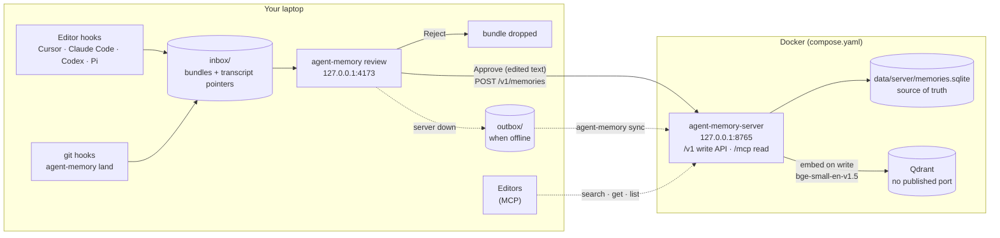

# Agent memory


Agent memory files a coding-agent session, or a slice of git history, and lets you choose what to keep. Only the notes you approve are saved, and only those notes are embedded for search.

## How it works

Hooks file each session or commit into a local inbox. Nothing is kept until you approve it on the review page, where you can also edit the text. Approve sends the note to the agent-memory server in Docker, which stores it and embeds it. Only approved notes reach the server. Transcripts stay on your laptop. Editors read the kept notes through MCP at `/mcp` (`search`, `get`, `list`; this repo's `.mcp.json` registers it).



[docs/server.md](docs/server.md) describes the server: routes, auth, browser rules and `reindex`. [docs/server-plan.md](docs/server-plan.md) is the plan it was built from.

## Install

You need [uv](https://docs.astral.sh/uv/) and Docker with Compose. From a clone of this repo:

```
./scripts/install
./scripts/setup
```

`install` runs `uv tool install --editable .`, so the `agent-memory` on your `PATH` runs this clone's code. `setup` builds the server image from the clone, starts it and Qdrant with `docker compose`, waits for `/v1/health`, and writes `~/.config/agent-memory/server` with `url = http://127.0.0.1:8765` if that file is missing. Auth is off locally, and only loopback can reach the server.

Without a clone, install the CLI with `uv tool install git+https://github.com/roune/agent-memory`, and run the published image `ghcr.io/roune/agent-memory-server` with the release's `compose.yaml`. [docs/deploy.md](docs/deploy.md) has those steps, a team server with auth on (`compose.team.yaml`), and how a release is made.

The CLI keeps its inbox, outbox, `review.json` and `capture.log` in `${XDG_DATA_HOME:-~/.local/share}/agent-memory/`, or in `AGENT_MEMORY_DIR` when that is set. An older install kept them in the clone. The first command after the upgrade moves them, and `agent-memory install` points the hooks it wrote at the installed command. See [Upgrading the CLI](docs/deploy.md#upgrading-the-cli-to-the-tool-install).

`install` leaves Cursor, Claude Code, Codex, and Pi alone. Connecting those is a second command, and it asks before it writes:

```
agent-memory install
```

Pass `--yes` to skip that prompt. To set up one git repository in the same step, pass its path. The command then asks whether to install post-commit and post-merge hooks, and whether those hooks should approve the commit message without the review page:

```
agent-memory install --git-repo /path/to/repo
```

With `--yes` and `--git-repo`, also pass `--install-git-hooks true` or `false`. Add `--install-auto-approve true` to approve those git drafts immediately. Omitting it leaves auto-approve off.

## Quick start

To build the memory for one repository, from a clone of this repo:

```
./scripts/install                                   # put agent-memory on PATH
./scripts/setup                                     # start Qdrant and the server
agent-memory install --git-repo /path/to/repo       # editor hooks, and git hooks for that repo
agent-memory land /path/to/repo --since 2026-01-01  # file its git history, grouped by PR
agent-memory review                                 # approve or reject the drafts
agent-memory connect --editor claude-code           # MCP tools in your editor: claude-code, cursor, codex
```

Pick a `--since` date before the repo's first commit. `--editor` takes a comma-separated list, such as `claude-code,cursor,codex`. Pi has no MCP entry. From then on, the hooks file new commits and sessions. Sessions from before the install are not captured.

## Features

- **Session capture.** Hooks for Cursor, Claude Code, Codex, and Pi write an inbox bundle (which tool, which repo, the session id, and a pointer at the transcript) and return. The choice happens later, in review.
- **Review.** `agent-memory review` opens an approve/reject page on `127.0.0.1`, starting at port 4173. You keep one note per bundle: a `change`, a `learning`, or a `decision`, in the domain `code`, `architecture`, or `operations`. Edit the text before you approve. Reject drops the bundle. For a git bundle it also remembers the commits, so `land` and the git hooks do not offer them again.
- **Land.** `agent-memory land` files recent commits on a clone’s local default branch, grouped by pull request when it can tell the PR: from a `Merge pull request #N` commit, a subject ending in `(#N)`, or `gh` when it is installed. It asks `gh` once for the PRs merged in the window, not once per commit. It skips the merge commits themselves. The draft is the PR title and description, then each commit message, with trailers and template comments removed. A bundle's start and end times are its oldest and newest commit dates. These bundles always wait for review. Approve checks a git bundle's commits once more and drops it if they were kept meanwhile, for example by the git hook.
- **Pointers, not diffs.** An approved change stores every commit it explains and its PR number next to the text. The diff stays in git, and a reader gets it with `git show --stat <sha>…` or `gh pr view <number>`. The review page shows those commands. A commit can be missing from a clone, for example after a rebase, so check with `git cat-file -e <sha>` before reading one.
- **Git hooks.** With `git_hooks` on, post-commit and post-merge run `agent-memory git-hook`. Only commits on the default branch (the one `land` reads) are filed: a feature-branch commit is filed when it is merged or pulled into that branch. Each new commit becomes an inbox bundle whose draft is the commit message without its trailers. A merge, fast-forward or pull files every new single-parent commit, not only the tip, and never a merge commit's own message. Commits of one pull request (`Merge pull request #N`, or a subject ending in `(#N)`) become one bundle with that PR number. The hook doesn't call `gh`, so a PR merged by rebase, with no marker in its commits, is filed one commit at a time. `git pull --rebase` on a diverged default branch runs neither hook there, so run `land` to file what it brought in. With `auto_approve`, the draft is approved at once: it goes into the outbox, and a detached `agent-memory sync` sends it. The hook writes locally first and makes one short call to skip commits that are already kept or rejected, so it returns within about two seconds even when the server doesn't answer.
- **Repo policy.** `.agent-memory.toml` holds `capture`, `repo`, `git_hooks`, and `auto_approve`. `agent-memory config` shows them and can turn the git hooks and auto-approve on or off without reinstalling editor hooks. `capture = false` skips capture, `land`, and the git hooks for that clone.
- **Outbox.** When the server can't be reached, or answers with a 5xx, Approve and Reject queue the request in `outbox/` (next to `inbox/`, files mode 0600) and delete the bundle. `agent-memory sync` sends the queue in order. It also runs at the start of `review`, `land` and `list`. The review page shows how many items wait and how old the oldest is.
- **Index.** The server keeps approved memories in `data/server/memories.sqlite` and embeds each one on write with `BAAI/bge-small-en-v1.5`, into Qdrant on the compose network. Raw transcripts are never embedded.

## Use

Work in Cursor, Claude Code, Codex, or Pi. When a session ends, the hook files the inbox. Open the queue:

```
agent-memory review
```

The page lists sessions whose work is on the default branch, plus anything you pinned. A link on the page shows the rest of the inbox. If the server is already running, the command only opens its URL.

Approve sends the note to the server and removes the inbox folder. It needs a remote repo id from `origin` or from `repo` in `.agent-memory.toml`, and a change also needs the commit it explains. With auth off (the local setup), org, team, and person come from the form or from `~/.config/agent-memory/identity`. With auth on, your token sets person, and the page offers the orgs and teams the token allows (from `/v1/whoami`).

What the server answers decides what happens to the bundle:

- **Stored** (201, or 200 for an identical resend): the bundle is deleted.
- **No answer, or a 5xx:** the request waits in the outbox, the bundle is deleted, and the page says it is queued.
- **A 4xx:** the page shows the error and keeps the bundle. A 409 means that id is already kept with other text; the page shows that text, and a newer note replaces it through Supersedes. A 401 or 403 means the token needs `agent-memory connect` again.

```
agent-memory sync                  # send the outbox now
agent-memory sync --retry-failed   # send again what the server refused, after a fix
agent-memory sync --resolve <item> supersede   # a 409: send the queued text as a newer memory
agent-memory sync --resolve <item> drop        # a 409: keep the stored one, delete the queued text
agent-memory list --team platform --since 2026-11-01T00:00:00+00:00
agent-memory list --org acme --since 2026-11-01T00:00:00+00:00
agent-memory list --repo github.com/owner/name
```

`sync` stops at the first item the server doesn't take, so a server that is down costs one timeout and the order is kept. A 401 or 403 keeps the whole queue until you connect again. A 409 or another 4xx moves that item to `outbox/failed/`, where `sync` and the review page list it with its error. A 409 means different text is already kept under that id, so a retry gets 409 again: `sync` shows both texts, and `--resolve <item> supersede` sends yours as a new memory that supersedes the stored one, or `drop` keeps the stored one. See [docs/server.md](docs/server.md#the-outbox). `flush` is retired: it prints "use `agent-memory sync`".

`list` asks the server. To use another server, or a token, see [Connecting the CLI](docs/server.md#connecting-the-cli). `~/.config/agent-memory/database` and `databases` are no longer read, except by `agent-memory migrate`, which copies an old `data/memories.sqlite` into the server.

File commits that are already on the local default branch. The window defaults to the last 24 hours. `--since` takes an ISO-8601 time or a number of hours ago. The branch name comes from `origin/HEAD` when that local branch exists, otherwise `main` or `master`, and unpushed local commits are included:

```
agent-memory land /path/to/repo
agent-memory land /path/to/repo --since 72
```

Turn git hooks on or off later:

```
agent-memory config /path/to/repo
agent-memory config /path/to/repo --git-hooks true --auto-approve false
```

Let Claude Code, Cursor and Codex search the kept notes through MCP. It shows what it will write and asks first; with auth on, each editor gets its own read-only token:

```
agent-memory connect --editor claude-code,cursor,codex
```

Pin a draft, force a captured session into the default queue, drop a bundle, or remove the editor hooks and MCP entries this tool added:

```
agent-memory note --session-id my-note --kind learning --domain code --text "what to keep"
agent-memory keep <session-id>
agent-memory drop <session-id>
agent-memory uninstall
```

`note` files its draft under the tool `note`, in the repo you run it from. It stops if it can't find a remote repo id there (`repo` in `.agent-memory.toml`, else `origin`), because Approve would refuse it later. Notes kept before v0.1.0 stay on the server with the tool `cursor`, and so does an older note still in the inbox unless you pin its id again.

There is no embed step: Approve embeds. To embed every row again, or to drop the collections of other models, `scripts/embed --rebuild` and `scripts/embed --prune` stop the server, run `agent-memory-server reindex`, and start it again.

## Upgrading from the laptop store

Before the server, Approve wrote `data/memories.sqlite` and `scripts/embed` filled a `memories` collection on `127.0.0.1:6333`. To move that store:

1. Back it up: `sqlite3 data/memories.sqlite ".backup data/backups/memories-pre-server.sqlite"`.
2. `./scripts/setup`. It starts the server, and Qdrant without a published port.
3. `agent-memory migrate --dry-run`, then `agent-memory migrate`. A rerun is safe, so run it again if you approved anything before this upgrade.
4. `scripts/embed --prune` drops the legacy `memories` collection.
5. Check that `curl 127.0.0.1:6333` now fails: Qdrant is reachable only from the server.

The laptop file stays in place as a backup. The CLI no longer opens it, apart from `migrate`. See [docs/server.md](docs/server.md#connecting-the-cli).

## License

Noncommercial use is free under the [PolyForm Noncommercial License 1.0.0](LICENSE).

Required Notice: Copyright (c) 2026 Miguel Porcar (https://github.com/roune/agent-memory)

## Where to read next

- [docs/context.md](docs/context.md) — decisions already made.
- [docs/harnesses.md](docs/harnesses.md) — where each tool’s hook will live, and the capture constraints.
- [docs/integration.md](docs/integration.md) — how a person installs capture, and how the hooks stay off the network.
- [docs/vector-engine.md](docs/vector-engine.md) — why the engine is Qdrant server.
- [docs/embedding-model.md](docs/embedding-model.md) — the model the server runs, and the pinned checkpoint.
- [docs/research.md](docs/research.md) — the “what already does this” question, still open.
- [docs/server-plan.md](docs/server-plan.md) — the approved plan for moving to one server in Docker, in ordered PRs.
- [docs/distribution-plan.md](docs/distribution-plan.md) — the plan for installing without a clone: `agent-memory setup`, PyPI, and a Homebrew tap.
- [docs/server.md](docs/server.md) — the server: routes, auth, browser rules, the outbox, and `reindex`.
