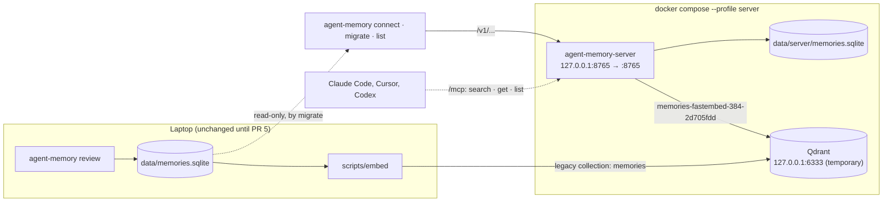
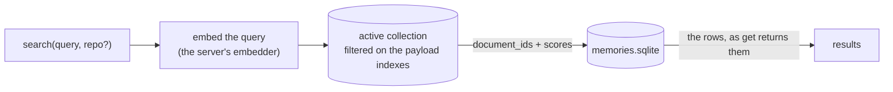
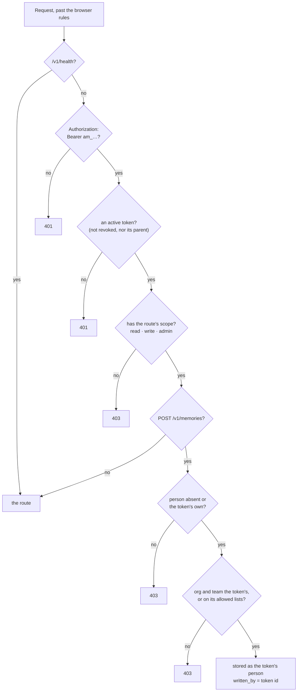
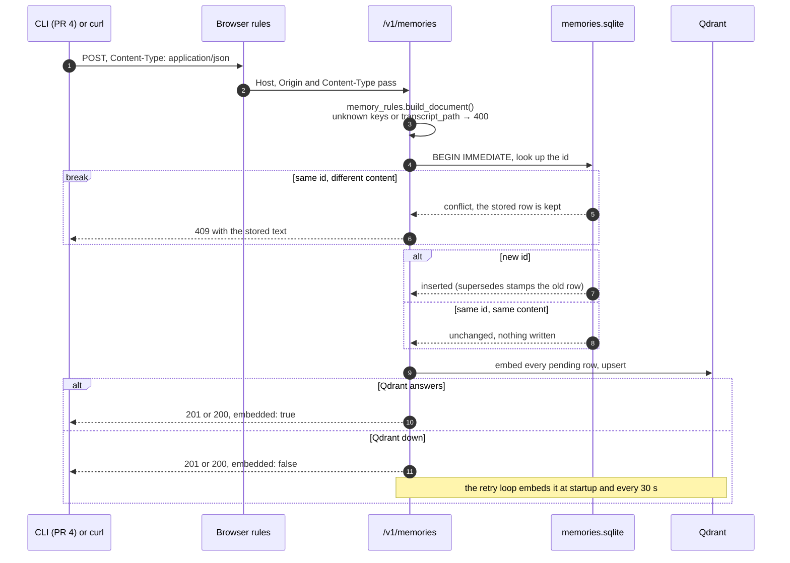
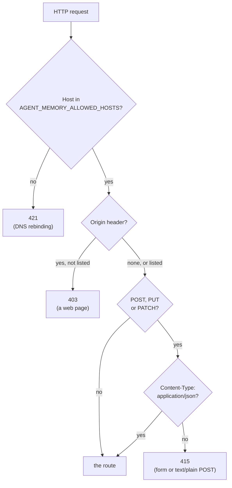
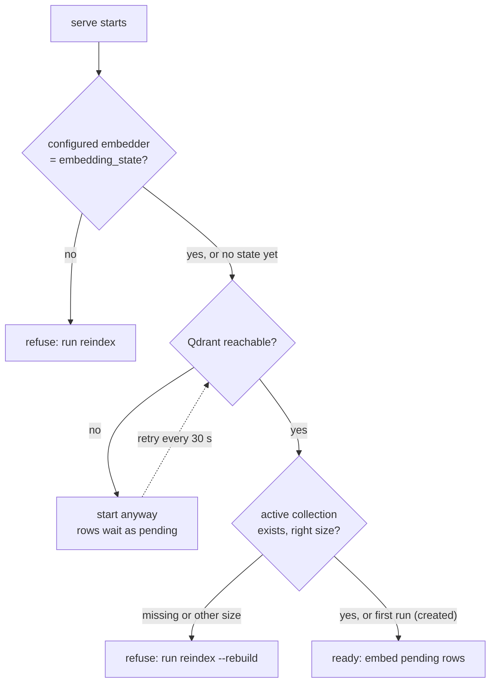

# The agent-memory server

Status: a preview, built in PR 2b, 2c, 3 and 4 of [server-plan.md](server-plan.md). Editors can query it through MCP. On the laptop, `agent-memory connect` points the CLI at it, `migrate` copies the local store into it, and `list` reads from it. `agent-memory review`, `land` and `scripts/embed` still use `data/memories.sqlite` and Qdrant on `127.0.0.1:6333`. PR 5 is the cutover.

## The shape



The server and the laptop never open the same SQLite file. Data moves between them only through `/v1/admin/import`, which `agent-memory migrate` uses. See [Connecting the CLI](#connecting-the-cli).

## Try it

```
./scripts/setup                                   # creates data/server and writes your uid/gid to .env
docker compose --profile server up -d --build
curl -s http://127.0.0.1:8765/v1/health
```

The server keeps its own `data/server/memories.sqlite`, separate from the laptop's file. It starts empty. `docker compose --profile server stop server` stops it.

The local `compose.yaml` turns auth off (`AGENT_MEMORY_AUTH=off`). That is safe only because it publishes the port on `127.0.0.1`, and because of the browser rules below. Anywhere else auth is on, which is the default: see [Auth and tokens](#auth-and-tokens).

## Connecting the CLI

```
agent-memory connect --url http://127.0.0.1:8765               # local, auth off
agent-memory connect --url https://memory.acme.internal --token-stdin < token.txt
agent-memory migrate --dry-run
agent-memory migrate
```

`connect` calls `/v1/whoami` first, and writes nothing if that fails: a server that doesn't answer, a missing token (401), or an unknown one. It then writes `~/.config/agent-memory/server` with mode 0600 and prints who you are connected as. The token is read from stdin, so it never shows up in your shell history or `ps`. `--mode` sets `shared` or `per-repo`; without it, connect keeps the current mode, or takes it from the legacy `database` file.

| File in `~/.config/agent-memory/` | Contents |
| --- | --- |
| `server` | `url`, `mode`, and `token` when auth is on. Mode 0600. |
| `servers` | Per-repo mode: `<remote id> = <server url>`. `connect --url … --repo <remote id>` adds a line. A remote not listed goes to the `server` file's url. |
| `tokens` | Per-repo mode: `<server url> = <token>`, written by `connect --repo`. Mode 0600. The `server` file's token is used only for its own url. |
| `database`, `databases` | Legacy. `connect` and `migrate` read the mode from `database`. |

**`migrate`** copies the laptop's `memories.sqlite` into the server. It needs a token with both the admin and read scopes (auth off implies every scope), and it checks that with `/v1/whoami` before sending anything.

- It opens the laptop file read-only and never changes it.
- Rows go to `/v1/admin/import` in batches of 50, each keeping its `id`, `person` and `updated_at`, and the rejected commits go with them.
- It then reads every id back and compares it with what it sent. It checks every rejection with `/v1/commits/status`, prints the server's own count, and exits 1 if anything is missing or different.
- A rerun is safe. The server keeps a row only when its `updated_at` is newer, so a second run writes nothing. A row the server holds at a later `updated_at`, such as one superseded there since the last run, is listed as "newer on the server" and kept. It doesn't count as a difference.
- `--dry-run` prints the counts for each server (memories, rejected commits, repos, people) and sends nothing.
- It reads both local layouts: `data/memories.sqlite` (shared mode) and every file under `~/.local/share/agent-memory/databases/` (per-repo mode). The legacy `database` file's mode names the one in use, and a file in the other layout, left from a mode change, is read too and named in the output, so nothing on the laptop is left behind. An id found in two files is refused. The `server` file's mode decides only where each row goes.
- The client never follows a redirect. urllib would send the token to whatever host the redirect names, so a 3xx is reported as an error.

Until the cutover, Approve still writes the laptop file, while `list` reads the server once `server` exists. So run `migrate` again to copy what you approved since the last run. PR 5 makes Approve send to the server.

**Times** are stored in UTC. Approve and the import convert an `occurred_at` with another offset, such as `+01:00` or `Z`. A bare date means midnight UTC, and a time without a zone is refused. The store compares and sorts these times as text, so every stored time has to be in the same form.

## Routes

| Route | Scope | Purpose |
| --- | --- | --- |
| `GET /v1/health` | none | Liveness, Qdrant readiness, auth on or off, the embedder and its collection, and the counts of memories and pending rows. |
| `GET /v1/whoami` | any token | The token's id, label, person, org, team, the orgs and teams it may write as, and its scopes. With auth off, it says identity comes from the request body. |
| `GET /v1/memories?team&org&repo&person&kind&domain&tool&session_id&since&until&limit&offset` | read | Metadata query. `since` and `until` are ISO-8601 times with a zone, or a date; they are compared in UTC, and anything else is a 400. |
| `GET /v1/memories/{id}` | read | One memory with its commits. 404 when missing. |
| `POST /v1/memories` | write | Approve. The body has the fields of the document `approve()` builds, and nothing else: an unknown key, `transcript_path` included, gets a 400. With auth on, `person` comes from the token (see below). Returns `{id, updated_at, embedded}`: 201 when new, 200 for an identical resend, 409 with the stored text for different content under an existing id. |
| `POST /v1/rejections` `{repo, shas}` | write | Remembers rejected commits. |
| `POST /v1/commits/status` `{repo, shas}` | read | `{commits: {sha: {kept, rejected}}}`. Abbreviated hashes match both ways. |
| `POST /v1/tokens` `{label}` | read and write | Mints a read-only child of the caller's token, for an editor. Returns the secret once. The same label again replaces the earlier child. A label is at most 64 characters, one line. 400 with auth off. |
| `POST /mcp` | read | MCP over streamable HTTP, with the read-only tools `search`, `get` and `list`. See [MCP](#mcp). |
| `POST /v1/admin/import` `{memories, rejections}` | admin | Bulk upsert of full rows, each with its own `id`, `person` and `updated_at`. A newer `updated_at` wins. Up to 500 of each per request. Returns `{written, skipped, rejections, newer}`, where `newer` lists the skipped ids the server holds at a later `updated_at`. |

With auth off, every caller has every scope.

## MCP

`/mcp` is the MCP SDK's streamable HTTP transport. It has three tools, and none of them writes. There is no write tool: a memory is kept only through `POST /v1/memories`, which the review flow calls.

| Tool | Arguments | Returns |
| --- | --- | --- |
| `search` | `query`, and optional `repo`, `domain`, `kind`, `org`, `team`, `person`, `limit` (10, at most 50) | `results`, best match first: each memory in `get`'s shape plus `score`. `not_yet_searchable` counts the rows still waiting to be embedded. |
| `get` | `document_id` | One memory with its commits, as `GET /v1/memories/{id}` returns it. |
| `list` | optional `repo`, `domain`, `kind`, `org`, `team`, `person`, `since`, `until`, `limit` (20, at most 100) | `memories`, newest `occurred_at` first. No ranking. `since` and `until` are ISO-8601 times with a zone, or a date (midnight UTC); anything else is a tool error. |



- **Superseded memories are returned.** A memory with `superseded_by` has a newer one, and that one has `supersedes`. Nothing is hidden, because a supersede may come from another org: the reader sees both notes and decides. Ranking by the caller's org is a later option.
- **The rows come from SQLite.** Qdrant only finds the ids. So `text` and `superseded_by` are current even when a point is still waiting for the retry loop.
- **Failures are tool errors.** Qdrant down, the collection missing, or an embedder mismatch makes `search` answer with `isError` and a message. The server keeps running, and `get` and `list` still work.
- **Auth.** With auth on, every request to `/mcp` needs a token with the `read` scope, checked before the SDK sees it. A session belongs to the token that opened it: another token gets a 404 for it, as if it didn't exist, and can't end it. A session doesn't outlive its token either: a revoked token gets a 401 on its next request.
- **Sessions** are the SDK's, kept in memory. After a restart a client's old session gets a 404, and the client starts a new one.

This repo's `.mcp.json` registers the local server for Claude Code as `agent-memory-dev`:

```json
{"mcpServers": {"agent-memory-dev": {"type": "http", "url": "http://127.0.0.1:8765/mcp"}}}
```

The local compose file has auth off, so it needs no token. The name keeps this project's entry from hiding a team server you register as `agent-memory`. For a server with auth on, add `"headers": {"Authorization": "Bearer am_…"}` with a read token, for example one from `POST /v1/tokens`. `agent-memory connect --editor` writes that for you in PR 6.

## Auth and tokens

With auth on, every route but `/v1/health` needs `Authorization: Bearer am_…`. A token is minted by a server command, shown once, and stored only as its sha256.



- **Scopes don't imply each other.** A laptop's token is `read,write`. An editor gets a read-only child from `POST /v1/tokens`, which needs both `read` and `write`, so a write-only token can't mint read access.
- **Admin is for `migrate` only.** `agent-memory migrate` (PR 4) needs `admin`. Mint a separate token for it, and revoke it when the move is done: import keeps each row's own `person`, so an admin token can write as anyone.
- **Identity:** `person` always comes from the token. `org` and `team` default to the token's own, and a write may name another only if the token lists it (`--allow-org`, `--allow-team`).
- **Children:** a child token belongs to the same person, with `read` only. Revoking a token revokes every token minted from it.
- **Import keeps people:** `/v1/admin/import` keeps each row's own `person`, because it moves memories that are already kept. That is why it needs `admin`.
- **Supersede crosses orgs.** A write may supersede a memory in any org, not only the token's own. The stamp links the old row to the new one (`superseded_by`); the old text never changes, and every read token still sees both. This is intended: each person answers for what they write. Controls on it can come later.

Mint and manage tokens next to the running server:

```
docker compose exec server agent-memory-server token create --person miguel --org acme --team platform \
  --scopes read,write [--allow-team infra] [--label laptop] [--same-person]
docker compose exec server agent-memory-server token create --person miguel --org acme --team platform \
  --scopes admin --label migrate --same-person       # for agent-memory migrate; revoke it afterwards
docker compose exec server agent-memory-server token list
docker compose exec server agent-memory-server token revoke t_1a2b3c4d5e6f
```

`token create` prints the secret once. It refuses a `--person` who already has an active token, unless you pass `--same-person`, so two people can't share a name by accident. `token list` never shows secrets or hashes. With auth on and no tokens yet, `serve` logs the command to create the first one.

## A write, step by step



## Browser rules

These apply to every route, `/mcp` included, whether auth is on or off:



- A `Host` that isn't in `AGENT_MEMORY_ALLOWED_HOSTS` gets a 421. The default is `127.0.0.1:8765,localhost:8765`.
- A request with an `Origin` that isn't in `AGENT_MEMORY_ALLOWED_ORIGINS` gets a 403. The default allows none. The CLI sends no `Origin`.
- A `POST`, `PUT` or `PATCH` without `Content-Type: application/json` gets a 415. `DELETE` has no body: an MCP client ends its session with one, often without a `Content-Type`, and a browser can't send it cross-site without a preflight, which the server never answers.

## Embedding



Each embedder gets its own Qdrant collection, `memories-<provider>-<dimension>-<hash8>`. The default is `memories-fastembed-384-2d705fdd`. The collection's metadata records the provider, model, revision, dimension and distance, and so does the `embedding_state` row in `memories.sqlite`.

- **On write:** every row the active collection lacks is embedded, including an old row whose `superseded_by` just changed.
- **Qdrant down:** the row is still stored and the response says `embedded: false`. The server tries again at startup and every 30 seconds (`AGENT_MEMORY_EMBED_RETRY`).
- **Mismatch:** at startup the server compares the configured embedder with `embedding_state`, and with the live collection's vector size. On any mismatch it refuses to start, and names the command that fixes it.

In compose, the variables in the settings table below come from `.env`. To switch models, set `AGENT_MEMORY_EMBEDDER` and `AGENT_MEMORY_EMBED_MODEL` there, then run `reindex` as below.

## Commands

```
agent-memory-server serve [--host 0.0.0.0] [--port 8765]
agent-memory-server reindex [--rebuild] [--prune [--yes] [--include-legacy]]
agent-memory-server token create | list | revoke
```

`serve` holds `/data/server.lock`. `reindex` takes the same lock, so stop the server first:

```
docker compose --profile server stop server
docker compose --profile server run --rm server agent-memory-server reindex
docker compose --profile server start server
```

- **`reindex`** embeds every row the configured embedder's collection lacks. It checks that the point count matches the row count, then makes that collection the active one.
- **`--rebuild`** drops that collection first.
- **`--prune`** lists the other collections whose name starts with `memories`. With `--yes` it deletes them.

`--prune` keeps the legacy `memories` collection, because the laptop's `scripts/embed` still writes it until the cutover. `--prune --yes --include-legacy` deletes it too; PR 5 runs that after the cutover.

## Settings

| Variable | Default | Meaning |
| --- | --- | --- |
| `AGENT_MEMORY_AUTH` | `on` | `off` turns auth off; the local `compose.yaml` sets it. Anything else means bearer tokens. |
| `AGENT_MEMORY_SERVER_DATA` | `/data` | `memories.sqlite` and `server.lock`. |
| `AGENT_MEMORY_QDRANT_URL` | `http://qdrant:6333` | Qdrant on the compose network. |
| `AGENT_MEMORY_QDRANT_API_KEY` | none | Sent as `api-key` when Qdrant has one. |
| `AGENT_MEMORY_ALLOWED_HOSTS` | `127.0.0.1:8765,localhost:8765` | See the browser rules. If you publish another port, list it here and keep `127.0.0.1:8765`, which the image's health check sends. |
| `AGENT_MEMORY_ALLOWED_ORIGINS` | none | See the browser rules. |
| `AGENT_MEMORY_MODELS_DIR` | `/opt/agent-memory/models` in the image | Where the baked checkpoint is. The image sets `HF_HUB_OFFLINE=1`, so the server never downloads a model. |
| `AGENT_MEMORY_EMBEDDER`, `AGENT_MEMORY_EMBED_MODEL` | `fastembed`, `BAAI/bge-small-en-v1.5` | See [embedding-model.md](embedding-model.md). |

## Tests

`python3 -m unittest discover -s scripts -p 'test_*.py'` runs everything that needs only the standard library. That includes the store, request rules, tokens and identity, embedding, reindex, lock, and CLI, with a `HashEmbedder` and an in-memory Qdrant. `test_server_client.py` checks the CLI's config files, `connect`, `migrate` and `list` against a stub server on `127.0.0.1`, using real urllib requests. `scripts/test-server` runs the same suite under `uv run --extra server`, which adds the HTTP route tests and `/mcp` through the SDK's session manager (`test_server_mcp.py`), and one `migrate` run against the real app. CI runs both. It also builds the image, checks that `/v1/health` answers with auth on and off, that `/v1/whoami` and `/mcp` need a token, and that a read token made with `token create` works for both. Last, the CLI on the runner runs `connect`, `migrate` (twice) and `list` against the image.
