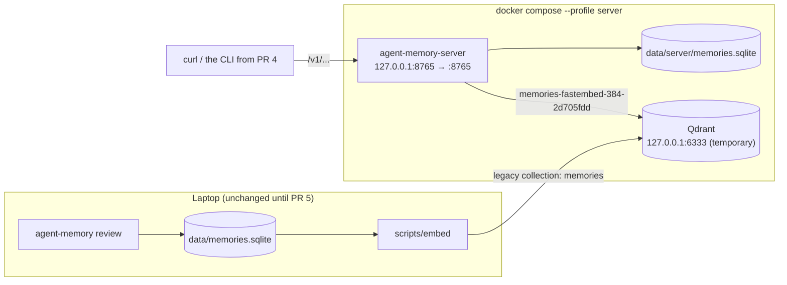
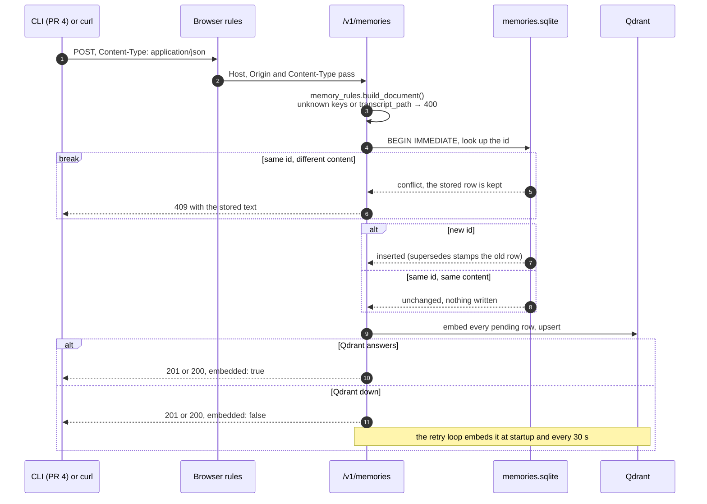
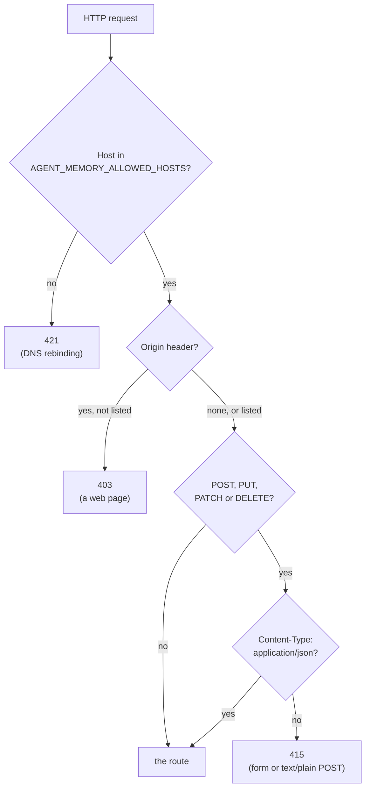
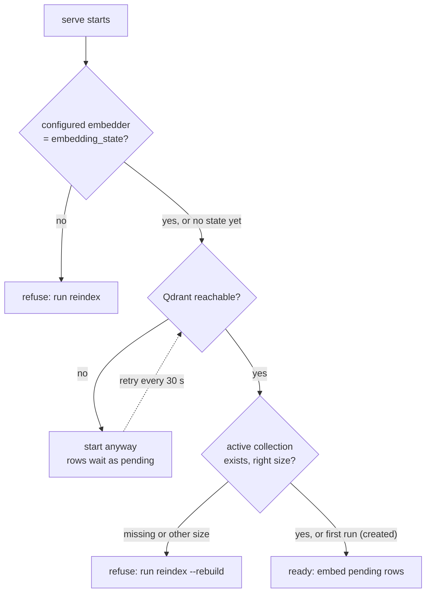

# The agent-memory server

Status: a preview, built in PR 2b of [server-plan.md](server-plan.md). Nothing on the laptop talks to it yet. `agent-memory review`, `land` and `scripts/embed` still use `data/memories.sqlite` and Qdrant on `127.0.0.1:6333`. PR 4 adds the client, and PR 5 is the cutover.

## The shape



The server and the laptop never open the same SQLite file. Data moves between them only through `/v1/admin/import`, which `agent-memory migrate` uses in PR 4.

## Try it

```
./scripts/setup                                   # creates data/server and writes your uid/gid to .env
docker compose --profile server up -d --build
curl -s http://127.0.0.1:8765/v1/health
```

The server keeps its own `data/server/memories.sqlite`, separate from the laptop's file. It starts empty. `docker compose --profile server stop server` stops it.

Auth is off in this version. That is safe only because compose publishes the port on `127.0.0.1`, and because of the browser rules below. With any other `AGENT_MEMORY_AUTH` value the server refuses to start, until PR 2c adds tokens.

## Routes

| Route | Purpose |
| --- | --- |
| `GET /v1/health` | Liveness, Qdrant readiness, the embedder and its collection, and the counts of memories and pending rows. |
| `GET /v1/whoami` | Reports auth off. With auth off, identity comes from the request body. |
| `GET /v1/memories?team&org&repo&person&kind&domain&tool&session_id&since&until&limit&offset` | Metadata query. |
| `GET /v1/memories/{id}` | One memory with its commits. 404 when missing. |
| `POST /v1/memories` | Approve. The body has the fields of the document `approve()` builds, and nothing else: an unknown key, `transcript_path` included, gets a 400. Returns `{id, updated_at, embedded}`: 201 when new, 200 for an identical resend, 409 with the stored text for different content under an existing id. |
| `POST /v1/rejections` `{repo, shas}` | Remembers rejected commits. |
| `POST /v1/commits/status` `{repo, shas}` | `{commits: {sha: {kept, rejected}}}`. Abbreviated hashes match both ways. |
| `POST /v1/admin/import` `{memories, rejections}` | Bulk upsert of full rows, each with its own `id`, `person` and `updated_at`. A newer `updated_at` wins. Up to 500 of each per request. |

## A write, step by step



## Browser rules

These apply to every route, `/mcp` included, whether auth is on or off:



- A `Host` that isn't in `AGENT_MEMORY_ALLOWED_HOSTS` gets a 421. The default is `127.0.0.1:8765,localhost:8765`.
- A request with an `Origin` that isn't in `AGENT_MEMORY_ALLOWED_ORIGINS` gets a 403. The default allows none. The CLI sends no `Origin`.
- A `POST`, `PUT`, `PATCH` or `DELETE` without `Content-Type: application/json` gets a 415.

## Embedding



Each embedder gets its own Qdrant collection, `memories-<provider>-<dimension>-<hash8>`. The default is `memories-fastembed-384-2d705fdd`. The collection's metadata records the provider, model, revision, dimension and distance, and so does the `embedding_state` row in `memories.sqlite`.

- **On write:** every row the active collection lacks is embedded, including an old row whose `superseded_by` just changed.
- **Qdrant down:** the row is still stored and the response says `embedded: false`. The server tries again at startup and every 30 seconds (`AGENT_MEMORY_EMBED_RETRY`).
- **Mismatch:** at startup the server compares the configured embedder with `embedding_state`, and with the live collection's vector size. On any mismatch it refuses to start, and names the command that fixes it.

## Commands

```
agent-memory-server serve [--host 0.0.0.0] [--port 8765]
agent-memory-server reindex [--rebuild] [--prune [--yes]]
```

`serve` holds `/data/server.lock`. `reindex` takes the same lock, so stop the server first:

```
docker compose --profile server stop server
docker compose --profile server run --rm server agent-memory-server reindex
docker compose --profile server start server
```

- **`reindex`** embeds every row the configured embedder's collection lacks. It checks that the point count matches the row count, then makes that collection the active one.
- **`--rebuild`** drops that collection first.
- **`--prune`** lists the other collections whose name starts with `memories`. With `--yes` it deletes them.

**Before the cutover, don't run `--prune --yes`.** The laptop's `scripts/embed` still writes the legacy `memories` collection, and `--prune --yes` would delete it.

## Settings

| Variable | Default | Meaning |
| --- | --- | --- |
| `AGENT_MEMORY_AUTH` | `on` | `off` is the only value that starts the server until PR 2c. |
| `AGENT_MEMORY_SERVER_DATA` | `/data` | `memories.sqlite` and `server.lock`. |
| `AGENT_MEMORY_QDRANT_URL` | `http://qdrant:6333` | Qdrant on the compose network. |
| `AGENT_MEMORY_QDRANT_API_KEY` | none | Sent as `api-key` when Qdrant has one. |
| `AGENT_MEMORY_ALLOWED_HOSTS` | `127.0.0.1:8765,localhost:8765` | See the browser rules. |
| `AGENT_MEMORY_ALLOWED_ORIGINS` | none | See the browser rules. |
| `AGENT_MEMORY_MODELS_DIR` | `/opt/agent-memory/models` in the image | Where the baked checkpoint is. The image sets `HF_HUB_OFFLINE=1`, so the server never downloads a model. |
| `AGENT_MEMORY_EMBEDDER`, `AGENT_MEMORY_EMBED_MODEL` | `fastembed`, `BAAI/bge-small-en-v1.5` | See [embedding-model.md](embedding-model.md). |

## Tests

`python3 -m unittest discover -s scripts -p 'test_*.py'` runs everything that needs only the standard library. That includes the store, request rules, embedding, reindex, lock, and CLI, with a `HashEmbedder` and an in-memory Qdrant. `scripts/test-server` runs the same suite under `uv run --extra server`, which adds the HTTP route tests. CI runs both, and also builds the image and checks that `/v1/health` answers.
